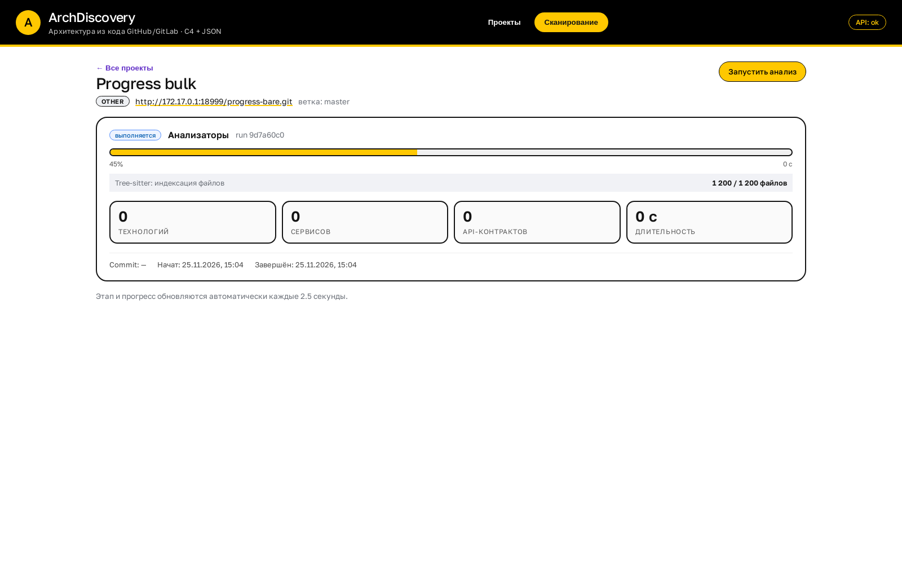
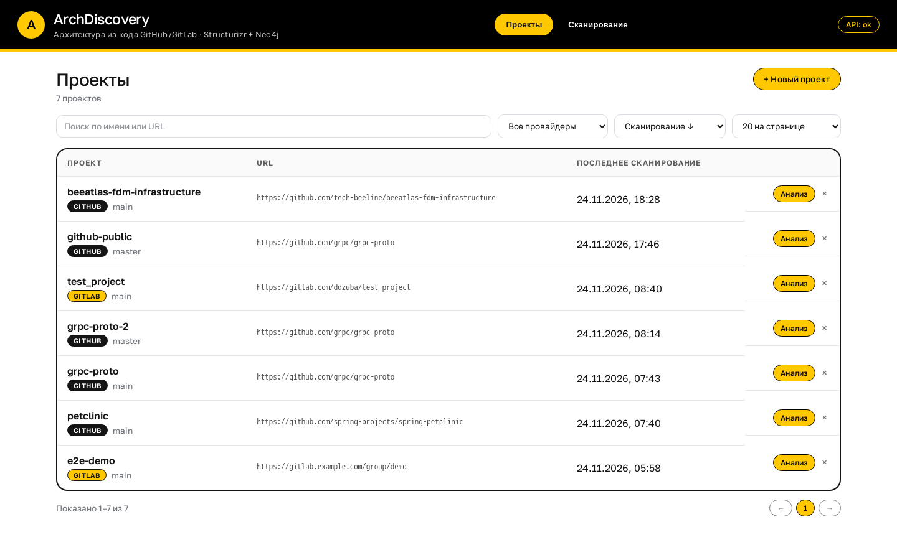
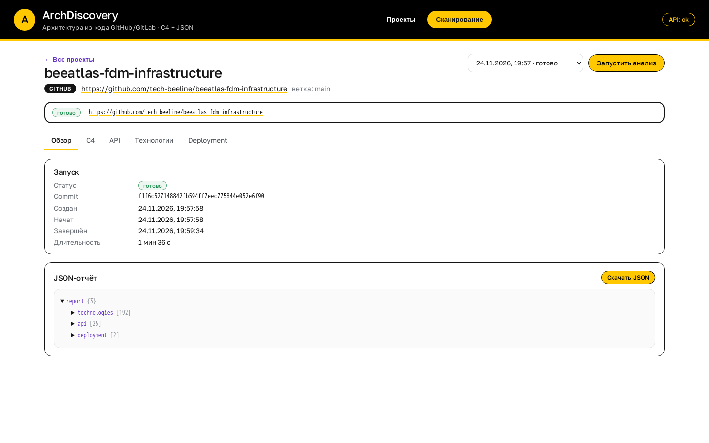
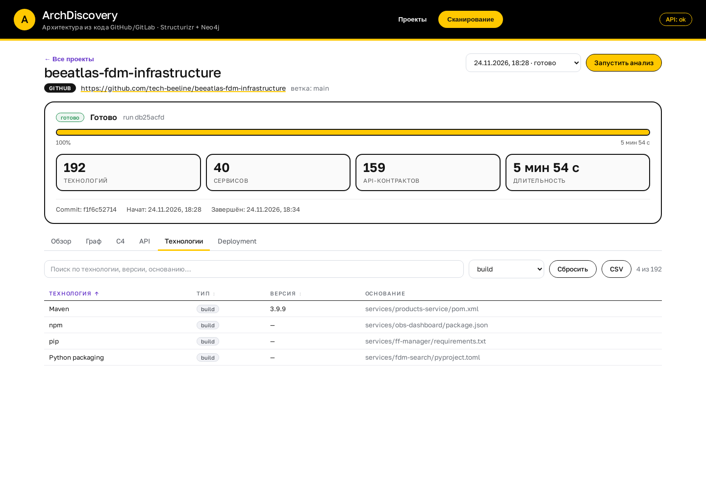
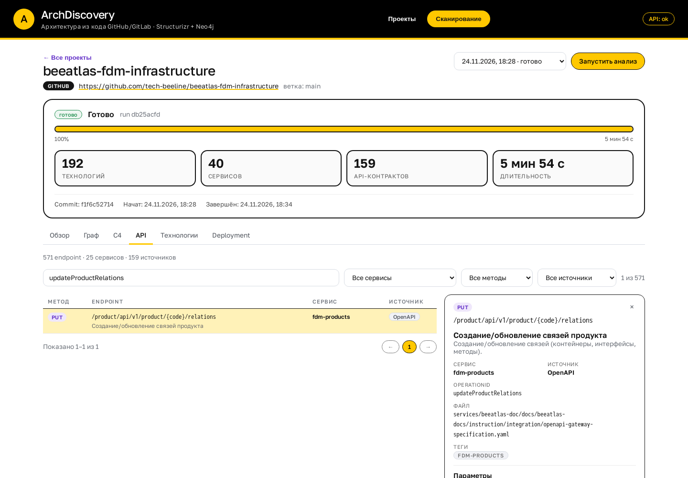
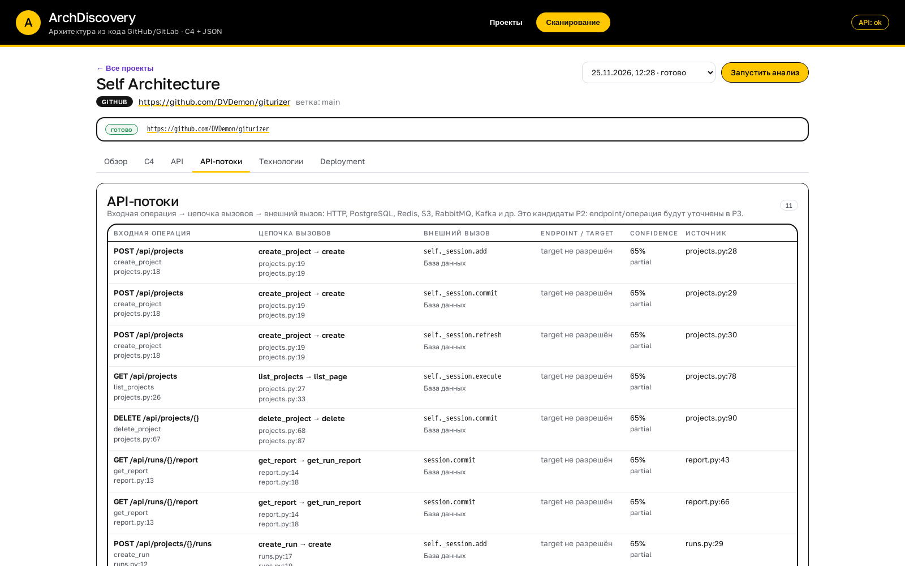
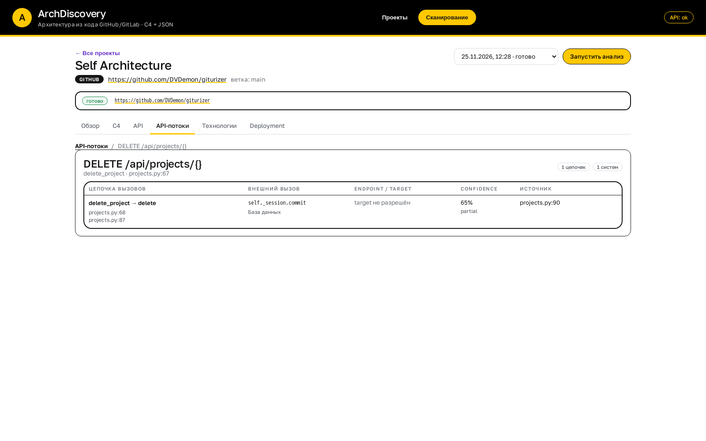
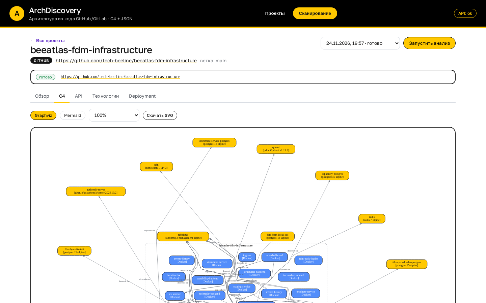

# ArchDiscovery

Сервис анализа архитектуры: по URL репозитория GitHub или GitLab выгружает код, восстанавливает архитектуру
(связи, API, технологии, deployment) и отдаёт единый JSON-отчёт: технологии, API и deployment.

- Архитектура: [docs/architecture.md](docs/architecture.md)
- Как резолвятся API-flow: [docs/api-flow-resolution.md](docs/api-flow-resolution.md)
- Аудит анализа BeeAtlas по документации: [docs/audit-beeatlas-docs.md](docs/audit-beeatlas-docs.md)
- Решения (ADR): [docs/adr/README.md](docs/adr/README.md)
- План разработки: [docs/plan/development-plan.md](docs/plan/development-plan.md)
- План тестирования: [docs/plan/test-plan.md](docs/plan/test-plan.md)

## Статус

**v1.0** — все фазы P0–P7 реализованы: каркас и CI, проекты/запуски, клон с submodules и анализаторы (ArchGuard + C++),
извлечение API (OpenAPI/gRPC/GraphQL/аннотации) и deployment (compose/Dockerfile/k8s/Helm/ArgoCD/
GitLab CI) с версиями технологий, единый JSON-отчёт, C4 Graphviz, API-каталог,
пагинация/прогресс запусков и веб-интерфейс.
Добавлены хардненинг (cap_drop/no-new-privileges, unprivileged nginx, шифрование токенов,
очистка клонов) и runbook.

- [Runbook (эксплуатация)](docs/runbook.md)
- [Дизайн-система (Beeline brandbook)](docs/design-system.md)
- [Архитектура](docs/architecture.md), [ADR](docs/adr/README.md), [планы](docs/plan/README.md)


### Проверка после установки

```bash
curl -fsS http://localhost:8000/health
PROJECT_ID=<id> bash scripts/smoke.sh   # или GITLAB_URL=... GITLAB_TOKEN=... bash scripts/smoke.sh
make smoke
```

### Веб-интерфейс

Открыть `WEB_PORT` (по умолчанию `http://localhost:8080`). Два верхних таба:

- **Проекты** — таблица проектов с поиском (имя/URL), фильтром провайдера,
  сортировкой (имя/URL/создание/последнее сканирование) и пагинацией
  **10/20/50/100**. Колонки: имя, URL, дата последнего сканирования.
  Здесь же создание проекта («+ Новый проект»), запуск анализа и удаление.
- **Сканирование** — детали выбранного проекта: проект, статус, текущий этап,
  прогресс-бар, длительность, счётчики технологий/сервисов/API. Для активного
  запуска данные обновляются каждые 2.5 с; после завершения доступны вкладки:
  **Обзор**, **C4**, **API**, **API-потоки**, **Технологии**, **Deployment**.
  Во время анализа показываются этап и детальный прогресс: обработано/всего файлов.


  После завершения анализа верхняя плашка с прогрессом скрывается — остаются URL,
  статус и вкладки.
  **Обзор** — статистика запуска и раскрывающееся JSON-дерево отчёта с кнопкой
  «Скачать JSON».
  **C4** — container-диаграмма Graphviz (fdp) с масштабом и SVG-экспортом;
  на связях показаны прикладной протокол и транспорт (`HTTP · TCP:8080`);
  переключатель на Mermaid сохранён. Вкладки C4/API/Deployment скрываются,
  если для них нет данных (C4 — если на диаграмме только один прямоугольник).
  **API** — каталог всех операций: поиск, фильтры по сервису/методу/источнику,
  пагинация; клик по строке → параметры, тело запроса и схемы ответов; deep link
  `?op=...`.

Клик по проекту открывает его текущее сканирование; deep link —
`/#scan/<project_id>`.

Во вкладке **Технологии** — поиск по имени/версии/основанию, фильтр по типу,
сортировка по колонкам (имя/тип/версия) и CSV-экспорт текущей выборки.









**API-потоки** — кандидаты P2 «входная операция → цепочка вызовов → внешний вызов».
Записи сгруппированы по входной операции; есть фильтры, сортировка, пагинация.
Строка открывает детальный экран с хлебными крошками и только цепочками выбранной операции.
Вкладка скрывается, если потоков нет.







### API

| Метод | Путь | Назначение |
|-------|------|------------|
| GET | `/health` | health-check |
| POST | `/api/projects` | создать проект (`repo_url` GitHub/GitLab, ветка опционально, токен опционально) |
| GET | `/api/projects?search=&provider=&sort=&order=&page=&per_page=` | проекты: пагинация, фильтры, `last_scan_at` |
| GET | `/api/projects/{id}` | проект |
| DELETE | `/api/projects/{id}` | удалить проект (каскадно удаляет запуски) |
| POST | `/api/projects/{id}/runs` | запустить анализ (`202`, `status=queued`) |
| GET | `/api/runs/{id}` | статус запуска |
| GET | `/api/projects/{id}/runs` | запуски проекта |
| GET | `/api/runs/{id}/results` | технологии, API, deployment, артефакты анализа |
| GET | `/api/runs/{id}/report` | единый JSON-отчёт (`technologies`, `api`, `deployment`, `api_flows`) |
| GET | `/api/runs/{id}/handlers` | endpoint → handler (Tree-sitter syntax-index) |
| GET | `/api/runs/{id}/outbound-calls` | handler → outbound HTTP-кандидат (call graph P2) |
| GET | `/api/runs/{id}/report?download=true` | скачать отчёт как файл |
| GET | `/api/runs/{id}/c4.model` | минимальная C4-модель для Mermaid |
| GET | `/api/runs/{id}/c4.svg` | C4 container diagram (Graphviz `fdp`, SVG) |

Публичные репозитории GitHub/GitLab клонируются без токена; ветка необязательна —
если не указана, сервис определяет её по умолчанию (`main`, `master`, …) и запоминает в проекте.

Формат отчёта:

```json
{
  "technologies": [{"name": "Spring Boot", "type": "framework", "version": "3.3.0", "description": "pom.xml"}],
  "api": [{"service": "products-service", "methods": [{"operation": "GET /products", "description": "...", "technology": "OpenAPI"}]}],
  "deployment": [{"method": "Docker Compose", "services": [{"name": "api", "image": "nginx", "image_version": "1.25", "ports": ["8080:80"], "dependencies": ["db"]}]}],
  "api_flows": [{"input": {"operation": "POST /orders", "handler": {"file": "Orders.java", "line": 42, "symbol": "create"}}, "path": [{"symbol": "create", "file": "Orders.java", "line": 42}], "output": {"callee": "restTemplate.exchange", "file": "Orders.java", "line": 57, "urls": ["/api/v1/invoices"], "kind": "http"}, "confidence": 0.75, "status": "partial"}]
}
```

### Что делает пайплайн

1. `worker` клонирует репозиторий в `/data/repos/<run_id>` (shallow, по ветке,
   с submodules через `--recurse-submodules --shallow-submodules`).
2. Определяет технологии **и версии**: теги образов, `FROM` в Dockerfile, `package.json`,
   `requirements.txt`/`pyproject.toml`, `pom.xml` (включая parent), `*.csproj`, Gradle/Maven
   (включая wrapper), `go.mod`, CMake (`find_package`, минимальная версия, C++ standard),
   `.nvmrc`/`.python-version`/`.java-version`.
3. Ставит анализаторы в очередь `analyzers` (контейнер `analyzer`): ArchGuard по языкам
   (Java/Kotlin/C#/TS/Python/Golang) и C++ (doxygen + include-граф).
4. Строит Tree-sitter syntax-index (Java/TS/Python/C++ POCO) для endpoint → handler,
   извлекает API (OpenAPI, gRPC, GraphQL, аннотации фреймворков) и модель развёртывания
   (compose, Dockerfile, Kubernetes, Helm, ArgoCD, GitLab CI) со сводкой.
5. Собирает единый JSON-отчёт: технологии, сервисы API с методами и deployment.
6. Сохраняет отчёт и внутреннюю C4-модель в PostgreSQL.

## Быстрый старт

```bash
cp .env.example .env      # при конфликте портов поменяйте API_PORT/WEB_PORT
make up                   # docker compose up -d --build
```

- API: http://localhost:8000/health (или `API_PORT` из `.env`)
- UI: http://localhost:8080 (или `WEB_PORT`)

Остановка:

```bash
make down
```

## Локальная разработка

```bash
make venv        # .venv + backend[dev]
make test        # pytest
make lint        # ruff + black --check
make typecheck   # mypy
```

## Контейнеры (docker-compose)

| Сервис | Назначение |
|--------|------------|
| `api` | FastAPI, REST API, health-check |
| `worker` | Celery-воркер очереди `pipeline` (оркестрация) |
| `analyzer` | Celery-воркер очереди `analyzers` (Tree-sitter, ArchGuard, doxygen) |
| `web` | React/TS SPA (заглушка на P0) |
| `postgres` | PostgreSQL 16 — метаданные и артефакты |
| `redis` | Redis 7 — брокер очередей |

`worker` и `analyzer` используют общий volume `data` (`/data`): клон репозитория доступен
анализатору по тому же пути.

## Лицензия

Apache License 2.0 — см. [LICENSE](LICENSE).
