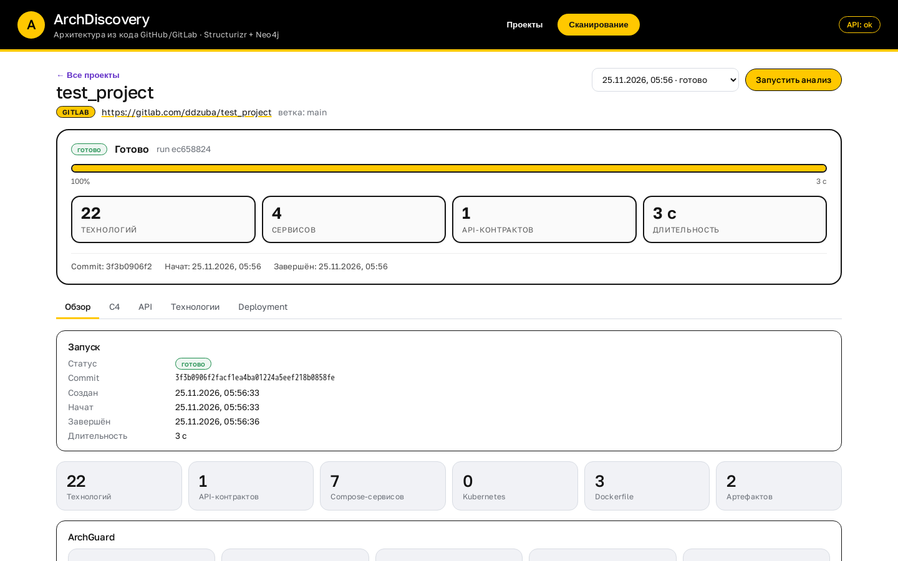

# ArchDiscovery

Сервис анализа архитектуры: по URL репозитория GitHub или GitLab выгружает код, восстанавливает архитектуру
(связи, API, технологии, deployment) и отдаёт результат в формате Structurizr (DSL + JSON).

- Архитектура: [docs/architecture.md](docs/architecture.md)
- Решения (ADR): [docs/adr/README.md](docs/adr/README.md)
- План разработки: [docs/plan/development-plan.md](docs/plan/development-plan.md)
- План тестирования: [docs/plan/test-plan.md](docs/plan/test-plan.md)

## Статус

**v1.0** — все фазы P0–P7 реализованы: каркас и CI, проекты/запуски, клон с submodules и анализаторы (ArchGuard + C++),
извлечение API (OpenAPI/gRPC/GraphQL/аннотации) и deployment (compose/Dockerfile/k8s/Helm/ArgoCD/
GitLab CI) с версиями технологий, Structurizr DSL/JSON + граф в Neo4j, веб-интерфейс.
Добавлены хардненинг (cap_drop/no-new-privileges, unprivileged nginx, шифрование токенов,
очистка клонов) и runbook.

- [Runbook (эксплуатация)](docs/runbook.md)
- [Дизайн-система (Beeline brandbook)](docs/design-system.md)
- [Архитектура](docs/architecture.md), [ADR](docs/adr/README.md), [планы](docs/plan/README.md)



### Проверка после установки

```bash
curl -fsS http://localhost:8000/health
PROJECT_ID=<id> bash scripts/smoke.sh   # или GITLAB_URL=... GITLAB_TOKEN=... bash scripts/smoke.sh
make smoke
```

### Веб-интерфейс

Открыть `WEB_PORT` (по умолчанию `http://localhost:8080`). Вкладки запуска:

- **Обзор** — статус, commit, длительность, метрики, предупреждения, экспорт;
- **Граф** — интерактивный граф (Cytoscape.js) с протоколами связей (PostgreSQL/TCP:5432,
  RESP/TCP:6379, MongoDB, HTTP) и легендой; клик по узлу → транзитивные зависимости;
- **C4** — диаграмма контейнеров/компонентов (Mermaid);
- **API** — OpenAPI через Redoc, gRPC/GraphQL/аннотации таблицами;
- **Технологии** — реестр с фильтром и CSV;
- **Deployment** — compose, Dockerfile, k8s, Helm, ArgoCD, GitLab CI.

Создание проекта: кнопка «+ URL» в сайдбаре; запуск анализа — кнопка «Анализ».

### API

| Метод | Путь | Назначение |
|-------|------|------------|
| GET | `/health` | health-check |
| POST | `/api/projects` | создать проект (`repo_url` GitHub/GitLab, ветка опционально, токен опционально) |
| GET | `/api/projects` | список проектов |
| GET | `/api/projects/{id}` | проект |
| DELETE | `/api/projects/{id}` | удалить проект (каскадно удаляет запуски) |
| POST | `/api/projects/{id}/runs` | запустить анализ (`202`, `status=queued`) |
| GET | `/api/runs/{id}` | статус запуска |
| GET | `/api/projects/{id}/runs` | запуски проекта |
| GET | `/api/runs/{id}/results` | технологии, API, deployment, артефакты анализа |
| GET | `/api/runs/{id}/structurizr` | DSL + JSON workspace |
| GET | `/api/runs/{id}/structurizr.dsl` | скачать `workspace.dsl` |
| GET | `/api/runs/{id}/structurizr.json` | скачать `workspace.json` |
| GET | `/api/runs/{id}/graph/elements` | элементы графа из Neo4j |
| GET | `/api/runs/{id}/graph/dependencies?element_id=&depth=` | транзитивные зависимости (Cypher) |

Публичные репозитории GitHub/GitLab клонируются без токена; ветка необязательна —
если не указана, сервис определяет её по умолчанию (`main`, `master`, …) и запоминает в проекте.

### Что делает пайплайн

1. `worker` клонирует репозиторий в `/data/repos/<run_id>` (shallow, по ветке,
   с submodules через `--recurse-submodules --shallow-submodules`).
2. Определяет технологии **и версии**: теги образов, `FROM` в Dockerfile, `package.json`,
   `requirements.txt`/`pyproject.toml`, `pom.xml` (включая parent), `*.csproj`, Gradle/Maven
   (включая wrapper), `go.mod`, CMake (`find_package`, минимальная версия, C++ standard),
   `.nvmrc`/`.python-version`/`.java-version`.
3. Ставит анализаторы в очередь `analyzers` (контейнер `analyzer`): ArchGuard по языкам
   (Java/Kotlin/C#/TS/Python/Golang) и C++ (doxygen + include-граф).
4. Извлекает API (OpenAPI, gRPC, GraphQL, аннотации фреймворков) и модель развёртывания
   (compose, Dockerfile, Kubernetes, Helm, ArgoCD, GitLab CI) со сводкой.
5. Строит C4-модель, генерирует Structurizr `workspace.dsl` + `workspace.json`, валидирует их.
6. Сохраняет снапшот в PostgreSQL и идемпотентно пишет граф в Neo4j.

## Быстрый старт

```bash
cp .env.example .env      # при конфликте портов поменяйте API_PORT/WEB_PORT
make up                   # docker compose up -d --build
```

- API: http://localhost:8000/health (или `API_PORT` из `.env`)
- UI: http://localhost:8080 (или `WEB_PORT`)
- Neo4j Browser: http://localhost:7474

Остановка:

```bash
make down
```

## Локальная разработка

```bash
make venv        # .venv + backend[dev]
make test        # pytest
make lint        # ruff + black --check
make typecheck   # mypy
```

## Контейнеры (docker-compose)

| Сервис | Назначение |
|--------|------------|
| `api` | FastAPI, REST API, health-check |
| `worker` | Celery-воркер очереди `pipeline` (оркестрация) |
| `analyzer` | Celery-воркер очереди `analyzers` (инструменты анализа) |
| `web` | React/TS SPA (заглушка на P0) |
| `postgres` | PostgreSQL 16 — метаданные и артефакты |
| `neo4j` | Neo4j 5 — граф архитектуры |
| `redis` | Redis 7 — брокер очередей |

`worker` и `analyzer` используют общий volume `data` (`/data`): клон репозитория доступен
анализатору по тому же пути.

## Лицензия

Apache License 2.0 — см. [LICENSE](LICENSE).
