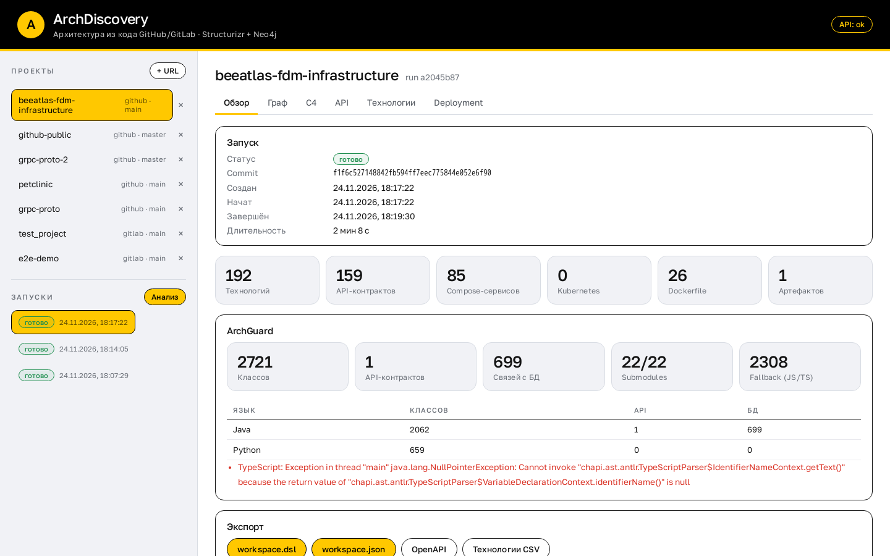

# ADR-0016: ArchGuard scanner в анализаторе и клонирование submodules

- **Статус:** Принято
- **Дата:** 2026-11-24

## Контекст

Архитектура предусматривала ArchGuard для Java/Kotlin/C#/TS, но в анализаторе
был только C++ (doxygen). Нужно проанализировать реальный репозиторий
`beeatlas-fdm-infrastructure`, где код лежит в 22 git-submodules и представлен
Java (2128 файлов), TypeScript (2274) и Python (206).

## Решение

- В образ `analyzer` добавляются **Java 21** (`default-jre-headless`) и
  **ArchGuard scanner CLI 2.3.0** (`scanner_cli-2.3.0-all.jar`, sha256-проверка).
- Языковые анализаторы и фичи **предзагружаются** в `/opt/archguard/analysers`
  (`lang_java`, `lang_python`, `lang_typescript`, `feat_apicalls`, `feat_datamap`,
  `idl_protobuf`, `idl_thrift`); при запуске они копируются в
  `<cwd>/dependencies/analysers`, поэтому сеть во время скана не нужна.
- Запуск — по одному языку (`--language`), Java с `--features apicalls/datamap`.
  Каждый язык независим: ошибка/таймаут попадает в `errors` артефакта и не
  валит остальные языки и пайплайн.
- Результат: сводный `archguard.json` — количества классов/API/БД по языкам,
  покрытие модулей (`services/<name>`) и submodules, API и БД-связи.
  Полный `codes.json` (27 МБ на 2000 классов) не пишется в БД.
- Клонирование — `git clone --recurse-submodules --shallow-submodules`;
  ветка по умолчанию определяется как раньше (ADR-0015).
- Модули, не покрытые ArchGuard (например, JS/TS при падении парсера),
  покрываются **fallback-сканом** файлов и локальных импортов; в артефакте
  это блок `fallback`, покрытие submodules считается по ArchGuard + fallback.

## Альтернативы

- Отдельный сервис ArchGuard backend — тяжелее и не нужен для статического JSON.
- Запуск сканера с сетью и скачиванием анализаторов — недетерминированно;
  предзагрузка надёжнее.
- Один вызов на все языки — CLI принимает один `--language`.

## Последствия

- (+) Java/Kotlin/C#/TS/Python/Golang анализируются в одном контейнере.
- (+) Submodules попадают в анализ; отчёт показывает покрытие по каждому.
- (−) Образ анализатора вырос (~Java + ~30 МБ анализаторов).
- (−) TS-анализатор 2.3.0 падает на части современного синтаксиса (NPE) —
  фиксируется в `errors`, Java/Python анализируются, TS-модули покрываются fallback-сканом.
- (−) Скан больших репозиториев занимает минуты; таймаут анализатора увеличен
  до 3600 с, клона — до 1200 с.

## Результат на `beeatlas-fdm-infrastructure`

- 22/22 submodules покрыты: Java — 2062 класса, 1 API, 699 связей с БД (14 модулей);
  Python — 659 классов (7 модулей); fallback JS/TS — 2308 файлов, 3228 импортов
  (`prospect-frontend`, `obs-dashboard`).
- TypeScript-анализатор ArchGuard 2.3.0 падает на современном синтаксисе (NPE),
  ошибка видна в `errors`; fallback закрывает покрытие модулей.
- Анализ (включая клон 22 submodules) занял ~2 минуты.
