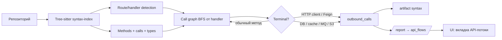

# Как резолвятся API-flow

Документ описывает фактический алгоритм P2: как из исходного кода получается
массив `api_flows` — «входная API-операция → цепочка вызовов → внешний вызов».

Связанные документы:

- [План API-flow](plan/api-flow-analysis.md)
- [P0 PoC](plan/api-flow-poc.md)
- [ADR-0023: Tree-sitter syntax-index](adr/0023-tree-sitter-syntax.md)
- [ADR-0024: call graph handler → outbound](adr/0024-outbound-callgraph.md)
- [ADR-0025: не-HTTP внешние вызовы](adr/0025-external-services-flow.md)

## 1. Общая схема



Основные файлы:

- [`analyzer/syntax/index.py`](../backend/src/archdiscovery/analyzer/syntax/index.py) — syntax-index;
- [`analyzer/syntax/routes.py`](../backend/src/archdiscovery/analyzer/syntax/routes.py) — endpoint → handler;
- [`analyzer/syntax/callgraph.py`](../backend/src/archdiscovery/analyzer/syntax/callgraph.py) — call graph и классификация;
- [`analyzer/syntax/analyze.py`](../backend/src/archdiscovery/analyzer/syntax/analyze.py) — сборка artifact;
- [`pipeline/report.py`](../backend/src/archdiscovery/pipeline/report.py) — `api_flows` в отчёте;
- [`services/report.py`](../backend/src/archdiscovery/services/report.py) — ленивое добавление для старых запусков;
- [`web/src/components/ApiFlowsPanel.tsx`](../web/src/components/ApiFlowsPanel.tsx) — вкладка UI.

## 2. Шаг 1: syntax-index

Анализатор запускается в контейнере `analyzer` и обрабатывает Java, TypeScript/TSX,
Python и C++ (POCO).

Правила обхода:

- расширения: `.java`, `.ts`, `.tsx`, `.py`, `.cpp`, `.cc`, `.cxx`, `.hpp`, `.hh`, `.h`;
- исключаются каталоги: `.git`, `node_modules`, `vendor`, `target`, `build`,
  `dist`, `generated`, `test`, `tests`, `fixtures`;
- файлы больше 2 МБ пропускаются;
- ошибка парсинга одного файла попадает в `errors`, остальные файлы продолжают
  обрабатываться;
- языки ограничиваются теми, что нашёл `detect_technologies` (Java,
  JavaScript/TypeScript, Python).

Для каждого файла Tree-sitter извлекает:

| Данные | Пример |
|---|---|
| imports/includes | `org.springframework.data.redis...`, `import httpx` |
| классы/интерфейсы | `ProjectService`, `BillingClient` |
| методы/функции | имя, класс, файл, строки, диапазон байт |
| аннотации/декораторы | `@PostMapping("/{id}")`, `@router.post` |
| вызовы | callee, caller, строка, аргументы-литералы, URL |
| type hints | `service: ProjectService`, `BillingService service`, `private billing: BillingService` |

### 2.1. Типы receiver’ов

Для разрешения `service.create()` недостаточно имени метода: `create` может быть
у нескольких классов. Типы выводятся так:

- class-level: типы полей/параметров класса;
- method-level: параметры и локальные объявления метода;
- Python/TS: `name: Type` (включая constructor params NestJS);
- Java: `Type name` для полей/параметров/локальных переменных;
- C++: `Type& name` / `Type* name` (POCO-компоненты вроде `PostgresStore& store_`).

Итоговая карта `method["types"]` объединяет типы класса и метода. Это позволяет
отличить `ProjectService.create` от `OtherService.create`.

Пример:

```python
@router.post("/api/projects")
def create_project(service: ProjectService = Depends(get_project_service)):
    return service.create(payload)
```

`service` получает тип `ProjectService`, поэтому `service.create` разрешается в
`ProjectService.create`.

## 3. Шаг 2: endpoint → handler

Handler — это функция/метод, зарегистрированный фреймворком как HTTP endpoint.
Не любой файл с импортом API-клиента и не клиентский интерфейс.

### 3.1. Поддерживаемые паттерны

| Язык / фреймворк | Признак | Confidence |
|---|---|---|
| Java Spring | `@RestController`/`@Controller` + `@RequestMapping`, `@GetMapping`, `@PostMapping`, ... | 0.95 |
| Java JAX-RS | `@Path` + `@GET`/`@POST`/... | 0.85 |
| NestJS | `@Controller` + `@Get`/`@Post`/... | 0.90 |
| Express/Fastify | `app.get/post`, `router.get/post`, `fastify.get/post` | 0.60 |
| FastAPI | `@router.post`, `@app.get`, ... + `APIRouter(prefix=...)` | 0.90 |
| Flask | `@app.route(..., methods=[...])` | 0.80 |
| C++ POCO | класс : `HTTPRequestHandler`, `dispatch`/`handleRequest`, условия `method` + `segments` | 0.80 |

Клиентские интерфейсы исключаются:

- `@FeignClient`-классы не считаются входными API;
- методы интерфейсов без контроллера не дают route;
- декораторы/аннотации привязываются к ближайшему class/function owner по
  диапазонам, а не к «текущей функции» (декоратор стоит до объявления).

### 3.2. Нормализация пути

- class-level prefix + method path:
  `@RequestMapping("/orders")` + `@PostMapping("/{id}/pay")`
  → `POST /orders/{}/pay`;
- `{id}` и `:id` нормализуются в `{}`;
- HTTP-метод приводится к верхнему регистру.

### 3.3. Confidence

Значения из таблицы выше попадают в handler, но не в `api_flows`; для flow
confidence определяется отдельно (см. §6).

## 4. Шаг 3: call graph от handler

### 4.1. Индексация

- `methods` группируются по имени;
- вызовы группируются по ключу `(file, owner_class, caller)`;
- Feign-клиенты (`@FeignClient`, `@HttpClient`) помечаются как terminal-классы.

### 4.2. Стартовая точка

Для каждого handler ищется метод с совпадением:

```text
file == handler.file
name == handler.symbol
class == handler.class (если задан)
```

Если метод не найден — handler пропускается.

### 4.3. Разрешение вызываемого метода

Для вызова `receiver.method`:

1. `this.`/`self.` отбрасывается;
2. receiver ищется в `method["types"]` (вывод типов);
3. если тип найден — берутся методы этого класса с именем `method`;
4. иначе проверяется точное имя класса-receiver;
5. `this`/`self` → методы текущего класса;
6. неизвестный receiver:
   - если метод с таким именем **единственный** — он выбирается;
   - если методов несколько — вызов **не размножается** по всем классам;
7. без receiver — сначала методы текущего класса, затем единственный кандидат.

Это ключевая защита от комбинаторного взрыва: в BeeAtlas первый вариант дал
9 562 «потока», после ограничения — 100 HTTP-кандидатов, затем с внешними
сервисами — 801 кандидат.

### 4.4. Обход

- BFS от handler;
- `visited` — глобальный на handler, а не на путь;
- глубина ≤ **6**;
- ≤ **50** outbound-кандидатов на handler;
- при terminal-вызове записывается путь `handler → ... → client` и обход этой
  ветки прекращается;
- результат дедуплицируется по `(input.operation, path, output.file, output.line)`.

## 5. Шаг 4: классификация внешнего вызова

### 5.1. HTTP

HTTP-вызов определяется по:

- callee: `axios`, `fetch`, `httpx`, `requests`, `aiohttp`, `RestTemplate`,
  `WebClient`, `OkHttp`, `HttpClient`, `HttpService`, `superagent`;
- Feign-классу (`@FeignClient`) или `@HttpClient`;
- наличию URL-литерала.

`kind = "http"`.

### 5.2. Не-HTTP

Проверяется callee + имена target-классов:

| kind | Маркеры |
|---|---|
| `postgresql` | postgres, psycopg, asyncpg, jdbc, jdbctemplate, r2dbc, Poco Data/PostgreSQL |
| `database` | sqlalchemy, datasource, repository |
| `redis` | redis, jedis, lettuce, redisson, ioredis, redis++ |
| `s3` | s3, boto3, aws-sdk/client-s3, minio |
| `rabbitmq` | rabbit, pika, amqp, rabbittemplate, AmqpClient |
| `kafka` | kafka, kafkatemplate, confluent, kafkajs |
| `mongodb` | mongo, mongotemplate |
| `elasticsearch` | elasticsearch, opensearch |

Дополнительно для типовых методов используются imports **исходного файла**:

- `execute`, `query`, `queryForObject`, `commit`, `add`, `refresh`, `flush`,
  `fetchone`, `fetchall` → PostgreSQL/database;
- `send`, `send_message`, `consume` → Kafka;
- `publish`, `basic_publish` → RabbitMQ/Kafka;
- `get`, `set`, `hget`, `hset` → Redis;
- `put_object`, `get_object` → S3.

Импорты target-файла **не** делают вызов внешним: иначе `service.create()` в
файле с SQLAlchemy ошибочно считался бы БД-вызовом. Внешность определяется
callee, target-классом (`*Repository`, `*Client`) или явным generic-методом.

### 5.3. Результат

```json
{
  "output": {
    "callee": "self._session.add",
    "file": "services/projects.py",
    "line": 28,
    "urls": [],
    "targets": [],
    "kind": "database"
  },
  "confidence": 0.65,
  "status": "partial"
}
```

`targets` — строковые литералы аргументов (до 5); для Redis это может быть ключ,
для Kafka — topic, для S3 — bucket/key, если они переданы литералом.

## 6. Confidence и status

Сейчас все P2-потоки имеют `status = "partial"`.

| Условие | Confidence |
|---|---|
| Внешний вызов с URL-литералом | 0.75 |
| Внешний вызов без URL | 0.65 |

`resolved` появится в P3, когда будет найдена конкретная внешняя операция
(метод + path/operation) и/или endpoint из каталога.

## 7. Куда попадает результат

1. `analyzer.syntax` пишет artifact `syntax.json`:
   - `handlers`;
   - `outbound_calls`;
   - `stats`, `errors`.
2. Worker сохраняет artifact `syntax` в `run_artifacts`.
3. `build_report` добавляет `api_flows` из `outbound_calls`.
4. Для старых запусков `get_run_report` лениво добавляет `api_flows` из artifact
   и обновляет снапшот.
5. `GET /api/runs/{id}/report` отдаёт:

```json
{
  "technologies": [],
  "api": [],
  "deployment": [],
  "api_flows": []
}
```

6. UI читает `api_flows` из отчёта и показывает вкладку **API-потоки**.
   Если массив пуст — вкладка скрыта.
7. Вкладка группирует записи по `input.operation`:
   - количество цепочек вызовов;
   - количество внешних систем (тип + host для абсолютного URL);
   - фильтры по тексту/типу, сортировка и пагинация;
   - клик по строке открывает детальный экран с breadcrumbs и только
     цепочками выбранной входной операции.

Дополнительные endpoints:

```text
GET /api/runs/{id}/handlers
GET /api/runs/{id}/outbound-calls
```

## 8. Примеры

### 8.1. Self Architecture: POST с DI

Код:

```python
@router.post("/api/projects")
def create_project(service: ProjectService = Depends(get_project_service)):
    return service.create(payload)
```

```python
class ProjectService:
    def create(self, payload):
        self._session.add(...)
        self._session.commit()
        self._session.refresh(...)
```

Разбор:

1. route: `POST /api/projects`, handler `create_project`;
2. тип `service` → `ProjectService`;
3. `service.create` → `ProjectService.create`;
4. `self._session.add/commit/refresh` → `database`;
5. результат:

```text
POST /api/projects
  create_project → create → self._session.add      database
POST /api/projects
  create_project → create → self._session.commit   database
POST /api/projects
  create_project → create → self._session.refresh  database
```

Каждая операция — отдельная строка; это ожидаемо для P2.

### 8.2. BeeAtlas: HTTP через RestTemplate

```text
GET /api/v1/influence/elements
  getInfluenceElements
  → getContextInfluenceElements
  → getAllProductsInfo
  → restTemplate.exchange("/api/v1/product/info")
```

- `kind = "http"`;
- URL `/api/v1/product/info` попадает в `urls`;
- confidence 0.75;
- статус `partial` (внешняя операция ещё не сопоставлена).

### 8.3. Feign

```java
@FeignClient(name = "billing")
interface BillingClient {
  @PostMapping("/api/v1/invoices")
  void createInvoice(String body);
}
```

`BillingClient` не считается входным API; его метод — terminal HTTP-клиент.
Вызов из handler записывается как `kind = "http"`.

### 8.4. C++/POCO

```cpp
if (method == "POST" && segments.size() == 1 && segments[0] == "users") {
    createUser(request, response);
    return;
}
```

→ `POST /users`, handler `createUser`.

```text
POST /users
  createUser → store_.createUser       postgresql
POST /users
  createUser → cache_.set              redis
POST /users
  createUser → producer_.publish       rabbitmq
```

Тип `store_` берётся из `PostgresStore& store_`, `cache_` — из
`RedisCache& cache_`, `producer_` — из `RabbitMQProducer& producer_`.

## 9. Ограничения P2

- неизвестный receiver с несколькими одноимёнными методами не разрешается;
- нет межпроцессного/межсервисного анализа;
- URL из конфигов, env, service discovery, Feign `name` не резолвятся;
- `api_flows` — кандидаты, а не подтверждённые внешние API-операции;
- `database` может означать любой SQL-репозиторий;
- возможны ложные срабатывания на похожих именах (`fetchone` больше не
  считается HTTP, но эвристики остаются);
- FastAPI `include_router(prefix=...)` не суммируется с prefix роутера;
- C++ поддерживает только POCO `dispatch`-паттерн; другие C++ фреймворки — P5;
- Kotlin/Go пока не входят в syntax-index;
- нет runtime-трафика, DI-прокси и reflection.

## 10. Диагностика

```bash
# artifact syntax
curl -s "$API/api/runs/$RUN_ID/results" | jq '.artifacts[] | select(.kind=="syntax") | .content.stats'

# handler'ы
curl -s "$API/api/runs/$RUN_ID/handlers" | jq '.stats, .handlers[0]'

# внешние вызовы
curl -s "$API/api/runs/$RUN_ID/outbound-calls" | jq '.stats, .calls[0]'

# отчёт
curl -s "$API/api/runs/$RUN_ID/report" | jq '.api_flows | length'
```

Если POST не найден:

1. проверьте, что route есть в `/handlers`;
2. проверьте, что `outbound_calls` содержит нужный handler;
3. проверьте логи `analyzer`;
4. проверьте, что тип receiver’а выводится (аннотация параметра/поля);
5. проверьте, не исключён ли файл (`tests`, `generated`, размер >2 МБ).

## 11. Что дальше (P3)

P3 добавит:

- разрешение URL/DSN/host/topic/bucket из конфигов;
- сопоставление с внешним API-каталогом;
- `status = resolved` и `confidence` выше;
- единый `api_flows` с `output.api`/`output.operation`;
- уточнение `database` до PostgreSQL/MySQL и т.п.
