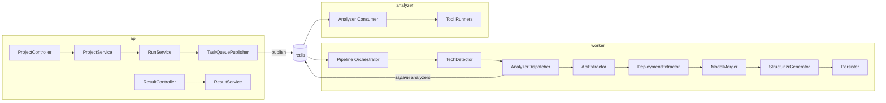

# Сервис анализа архитектуры (ArchDiscovery)

Рабочее название: **ArchDiscovery**.

Сервис принимает на вход URL репозитория GitHub или GitLab (публичного или с токеном),
выгружает и анализирует его исходный код,
и восстанавливает архитектуру: связи между компонентами/сервисами, API, технологии и библиотеки,
а также модель развёртывания. Канонический результат — рабочее пространство в формате **Structurizr**
(DSL + JSON), плюс спецификации API и реестр технологий.

## 1. Цель и назначение

- Принять URL репозитория **GitHub** или **GitLab** (HTTP(S)); публичные — без токена,
  приватные — с access token. Ветка может быть указана или определена автоматически.
- Выполнить полный цикл статического анализа кода.
- Построить архитектурную модель (C4-ориентированную): системы/сервисы, контейнеры, компоненты,
  зависимости, вызовы API, обращения к БД.
- Извлечь модель развёртывания из IaC/конфигурации в репозитории (Dockerfile, docker-compose,
  Kubernetes, Helm, ArgoCD, GitLab CI).
- Сгенерировать спецификации API (OpenAPI, gRPC, GraphQL, аннотации фреймворков).
- Сформировать реестр технологий и библиотек.
- Отдать результат в формате Structurizr (DSL + JSON workspace) и визуализировать в вебе.

## 2. Ключевые архитектурные решения (кратко)

| # | Решение | Значение | Статус |
|---|---------|----------|--------|
| 1 | Бэкенд | Python + FastAPI | Принято |
| 2 | БД | PostgreSQL (метаданные/артефакты) + Neo4j (граф) | Принято |
| 3 | Веб-визуализация | Свой вьюер (Cytoscape.js + Mermaid + Swagger UI/Redoc) | Принято |
| 4 | Модель выполнения | Асинхронная очередь (Redis + Celery) | Принято |
| 5 | Анализаторы | Долгоживущий контейнер `analyzer` + очередь задач | Принято |
| 6 | Источники развёртывания | Dockerfile/compose, k8s, Helm, ArgoCD, GitLab CI | Принято |
| 7 | Источники API | OpenAPI, gRPC/protobuf, GraphQL, аннотации фреймворков | Принято |
| 8 | Аутентификация | Одиночный пользователь / внутренний | Принято |
| 9 | Формат Structurizr | DSL + JSON (оба) | Принято |
| 10 | Хранение графа | Neo4j | Принято |
| 11 | Связь worker ↔ analyzer | Общая очередь + shared volume (без docker.sock) | Принято |
| 12 | Доступ к GitLab/GitHub | access token (опционально) | Принято |
| 13 | Провайдеры | GitHub (public) + GitLab, авто-ветка | Принято |

Полный реестр — в [`docs/adr/README.md`](adr/README.md).

## 3. Системный контекст (C4: Context)

```mermaid
flowchart LR
    U[Пользователь / архитектор] --> W[ArchDiscovery]
    W --> G[GitHub / GitLab (источник кода)]
    W --> R[Реестры Docker-образов]
    W --> D[PostgreSQL + Neo4j + Redis]
    W --> A[Анализаторы: ArchGuard, doxygen, pyan, dependency-cruiser, ...]
```

- **Пользователь** — архитектор/разработчик, вводит URL проекта, просматривает результаты.
- **GitHub / GitLab** — источник исходного кода. Публичные репозитории клонируются
  анонимно, приватные — по access token; провайдер определяется по URL.
- **Реестры образов** — необязательно: определения образов из Dockerfile/k8s/Helm.
- **PostgreSQL + Neo4j + Redis** — метаданные/артефакты, граф архитектуры и очередь задач.

## 4. Контейнеры (C4: Containers)

```mermaid
flowchart TB
    subgraph compose[Архитектура внутри docker-compose]
        WEB[web — SPA (React/TS)] --> API[api — FastAPI]
        API --> PG[(postgres)]
        API --> N4J[(neo4j)]
        API --> RD[(redis)]
        API -->|задача| RD
        RD --> WK[worker — Celery, очередь pipeline]
        RD --> AN[analyzer — Celery, очередь analyzers]
        WK --> PG
        WK --> N4J
        WK -->|clone| VOL[(volume data: repos / artifacts)]
        AN -->|read/write| VOL
        WK --> GIT[GitHub/GitLab clone]
    end
```

| Контейнер | Технология | Назначение |
|-----------|------------|------------|
| `web` | React + TypeScript (Vite), unprivileged nginx | SPA: ввод URL, список проектов/запусков, визуализация |
| `api` | Python + FastAPI | REST API, CRUD проектов/запусков, постановка задач, отдача результатов |
| `worker` | Python + Celery | Оркестрирует пайплайн (клон, детект, merge, persist), ставит задачи анализа в очередь |
| `analyzer` | Python + Celery + инструменты анализа | Долгоживущий воркер очереди `analyzers`: ArchGuard, doxygen, pyan, dependency-cruiser |
| `postgres` | PostgreSQL 16 | Метаданные + снапшоты Structurizr + артефакты |
| `neo4j` | Neo4j 5 | Граф архитектуры: элементы, связи, транзитивные запросы |
| `redis` | Redis 7 | Брокер очереди + кэш статусов |

> Примечание: анализаторы работают в долгоживущем контейнере `analyzer` и вызываются через очередь
> (`analyzers`). Клон репозитория и результаты передаются через общий volume `/data/repos` и
> `/data/artifacts`; Docker-сокет не используется (см. [ADR-0005](adr/0005-analyzer-runners.md),
> [ADR-0011](adr/0011-worker-analyzer-interaction.md)).

## 5. Компоненты бэкенда (C4: Components, контур `api` + `worker` + `analyzer`)



### 5.1 Пайплайн анализа (этапы)

1. **Ingest** — принимает URL GitHub/GitLab + параметры (токен, ветка, include/exclude), создаёт
   `Project` и `AnalysisRun(status=queued)`.
2. **Clone** — worker клонирует репозиторий в общий volume `/data/repos/<run_id>` (shallow, по ветке;
   если ветка не задана — определяется `git ls-remote --symref ... HEAD`, иначе `main`);
   путь доступен контейнеру `analyzer`.
3. **Tech detection** — определяет языки и фреймворки по манифестам
   (`pom.xml`, `build.gradle`, `*.csproj`, `CMakeLists.txt`, `requirements.txt`/`pyproject.toml`,
   `package.json`). Формирует первичный реестр технологий.
4. **Language analysis** — по обнаруженным языкам `worker` последовательно ставит задачи в очередь
   `analyzers`; контейнер `analyzer` выполняет соответствующие инструменты над клоном:
   - Java / Kotlin / C# / TS/JS → **ArchGuard scanner** (services map, API producers/consumers,
     database map, зависимости модулей/пакетов/классов/методов).
   - C++ → **doxygen** (call/include графы) + **cpp-dependencies** (`#include` в `.dot`).
   - Python → **pyan** (call graph) + **pyreverse** (UML классов/пакетов).
   - Node/TS → **dependency-cruiser** (граф модулей, правила) + **madge** (визуальный граф).

   Задачи выполняются по одной; `worker` дожидается результата каждой и забирает артефакт из
   `/data/artifacts/<run_id>`.
5. **API extraction** — извлекает и нормализует API-контракты (см. §6).
6. **Deployment extraction** — извлекает модель развёртывания (см. §7).
7. **Merge** — сводит результаты в единую внутреннюю модель архитектуры (граф элементов и связей
   в терминах C4 + deployment nodes + API + реестр технологий).
8. **Structurizr generation** — сериализует модель в Structurizr workspace (DSL + JSON).
9. **Persist** — пишет метаданные/снапшот в PostgreSQL, граф — в Neo4j (`MERGE` по `element_id`),
   артефакты и обновляет статус.
10. **Serve** — API отдаёт результат; веб рендерит.

## 6. Извлечение API

Источники (по [ADR-0007](adr/0007-api-sources.md)):

| Источник | Как извлекается | Нормализация |
|----------|-----------------|--------------|
| OpenAPI / Swagger | Парсинг `openapi.yaml/json`, Swagger-аннотации | OpenAPI 3.x как канон |
| gRPC / protobuf | Парсинг `*.proto` | RPC-сервисы → OpenAPI-подобная модель / protobuf-схема |
| GraphQL | Парсинг `*.graphql`/`*.gql` | Introspection-подобная схема |
| Аннотации фреймворков | Spring/JAX-RS (Java), ASP.NET (C#), FastAPI (Python), express-роуты (Node) | Endpoints (метод, путь, params, модель) |

Канонический формат хранения — OpenAPI 3.x (JSON) + метаданные (владелец-контейнер/сервис,
файл-источник, фреймворк). Для gRPC/GraphQL дополнительно сохраняется нативная схема.

## 7. Извлечение развёртывания (deployment)

Источники (по [ADR-0006](adr/0006-deployment-sources.md)):

| Источник | Что извлекается |
|----------|-----------------|
| `Dockerfile` / `docker-compose.yml` | образы, контейнеры, порты, volumes, env, сети |
| Kubernetes (Deployment/Service/Ingress/StatefulSet) | поды, сервисы, экспозиция, реплики, labels/selectors |
| Helm-чарты (`Chart.yaml`, `values.yaml`, `templates/`) | параметризованные k8s-ресурсы |
| ArgoCD (`Application`/`AppProject`) | связка git-репозитория ↔ кластер/namespace, sync policy |
| GitLab CI (`.gitlab-ci.yml`) | стадии, job'ы, окружения, образы раннеров |

Результат — `deploymentNodes` (Deployment Node → Container Instance) и `deploymentRelationships`
в терминах Structurizr, плюс связи «контейнер → deployment node».

## 8. Модель данных (PostgreSQL + Neo4j)

```text
projects(id, name, repo_url, provider, default_branch, token_encrypted, created_at)
analysis_runs(id, project_id, status, commit_sha, config jsonb, error text,
              started_at, finished_at)
architecture_snapshots(id, project_id, run_id, structurizr_dsl text,
                       structurizr_json jsonb, graph jsonb, generated_at)
api_specs(id, project_id, run_id, kind, name, spec jsonb)      -- openapi|grpc|graphql|annotations
tech_registry(id, project_id, run_id, technologies jsonb)      -- языки, фреймворки, библиотеки, версии
deployment_models(id, project_id, run_id, model jsonb)         -- nodes + relationships
artifacts(id, run_id, kind, path, content bytea/text)          -- dsl, openapi.yaml, raw outputs
```

- **Граф архитектуры** (elements + relationships) хранится в **Neo4j**; `architecture_snapshots.graph`
  (JSONB) — только слепок/экспорт для воспроизводимости и импорта, не источник для графовых запросов
  ([ADR-0010](adr/0010-graph-storage.md)). Транзитивные запросы — Cypher (`MATCH ... -[*1..N]-> ...`).
- Внутренний JSON-контракт элементов/связей максимально близок к Structurizr workspace JSON,
  чтобы минимизировать трансформации.

## 9. Генерация Structurizr-вывода

Из внутренней модели генерируются два артефакта одного workspace:

1. **`workspace.dsl`** — Structurizr DSL (текст), читаемый и редактируемый человеком.
2. **`workspace.json`** — Structurizr workspace JSON (машинный формат для импорта в
   Structurizr Lite / on-premises / клиентские библиотеки).

Правила маппинга: сервис (ArchGuard) → `softwareSystem`; контейнер (Dockerfile/k8s) → `container`;
модуль/пакет → `component`; вызов API → relationship с тегом `API`; обращение к БД → relationship
с тегом `Database`; `deploymentNodes` из §7. См. [ADR-0009](adr/0009-structurizr-output.md).

Связи несут **протоколы транспортного и прикладного уровня** (`transport`, `protocol`, `port`):
они определяются по образу/порту целевого сервиса и попадают в Structurizr (`technology` +
`properties`), Neo4j-рёбра и подписи на графе. Базовые правила:

| Цель | Прикладной | Транспорт | Порт |
|------|-----------|-----------|------|
| `postgres[:tag]` | PostgreSQL | TCP | 5432 |
| `mongo[:tag]` | MongoDB | TCP | 27017 |
| `redis` / `valkey` | RESP | TCP | 6379 |
| `nginx` / `swagger-ui` | HTTP | TCP | 80 |
| собираемый сервис без образа | HTTP | TCP | из `ports` |
| C++ include-граф | include (compile-time) | — | — |

## 10. Визуализация (веб)

Свой вьюер ([ADR-0003](adr/0003-frontend-viewer.md)):

- **Cytoscape.js** — интерактивный граф зависимостей (компоненты/сервисы), drill-down по узлам,
  фильтры, подсветка транзитивных зависимостей.
- **Mermaid** — рендер C4-диаграмм (System Context / Container / Component) из модели.
- **Swagger UI / Redoc** — просмотр извлечённых OpenAPI-спецификаций.
- Экспорт/скачивание: `workspace.dsl`, `workspace.json`, `openapi.json`, реестр технологий (JSON/CSV).

## 11. Развёртывание (docker-compose)

Сервисы (см. §4): `web`, `api`, `worker`, `analyzer`, `postgres`, `neo4j`, `redis`.

```yaml
# фрагмент docker-compose.yml (полная версия — в корне репозитория)
services:
  postgres:  { image: postgres:16, volumes: [pgdata:/var/lib/postgresql/data] }
  neo4j:     { image: neo4j:5,     environment: [NEO4J_AUTH=neo4j/archdiscovery],
               volumes: [neo4jdata:/data] }
  redis:     { image: redis:7-alpine }
  api:       { build: { context: ./backend,  dockerfile: Dockerfile.api },
               ports: ["${API_PORT:-8000}:8000"] }
  worker:    { build: { context: ./backend,  dockerfile: Dockerfile.worker },
               volumes: [data:/data] }
  analyzer:  { build: { context: .,          dockerfile: analyzer/Dockerfile },
               volumes: [data:/data] }
  web:       { build: ./web, ports: ["${WEB_PORT:-8080}:8080"] }
volumes: { data: {}, pgdata: {}, neo4jdata: {} }
```

Запуск: `docker compose up -d` → `web` на `:8080`, `api` на `:8000`.

## 12. Нефункциональные требования и границы

- **Изоляция**: анализаторы работают в выделенном контейнере `analyzer`; сбой одного инструмента не
  валит пайплайн (ошибки уровня инструмента ловятся и помечаются, остальные этапы продолжаются).
- **Масштаб**: количество проектов/запусков лимитируется очередью Celery; воркеры горизонтально
  масштабируются.
- **Безопасность**: access token (GitLab/GitHub) хранится зашифрованно (Fernet/KMS), ошибки клонирования
  редактируются; Docker-сокет не используется; контейнеры `api`/`worker`/`analyzer`/`web` —
  `no-new-privileges` + `cap_drop: ALL`, nginx unprivileged; наружу публикуются только
  `api`/`web`/`neo4j` (см. [ADR-0014](adr/0014-container-hardening.md)).
- **Ретеншн**: клон удаляется после запуска по умолчанию (`KEEP_REPOS=true` — оставить);
  артефакты хранятся в `/data/artifacts/<run_id>` (см. [ADR-0013](adr/0013-clone-retention.md)).
- **Границы v1**: монорепо поддерживается (несколько манифестов/языков в одном репо), но
  кросс-репозиторные зависимости и runtime-трафик (APM) не покрываются.

## 13. Открытые вопросы и roadmap

Пошаговый план реализации и стратегия тестирования — в
[`docs/plan/development-plan.md`](plan/development-plan.md) и
[`docs/plan/test-plan.md`](plan/test-plan.md).

- Покрытие C++ на уровне «сервисов» слабое (doxygen/cpp-dependencies дают только include/call-графы) —
  связь C++-модулей с API/сервисами остаётся ручной.
- Поддержка монорепо с несколькими deployables и маппинг «код ↔ сервис» требует уточнения.
- Граф архитектуры хранится в Neo4j (см. [ADR-0010](adr/0010-graph-storage.md)); двойная запись
  PostgreSQL/Neo4j и её согласованность — зона особого внимания при реализации Persist.
- Мультиарендность и GitLab/GitHub OAuth — отложены до v2 ([ADR-0008](adr/0008-auth.md)).
