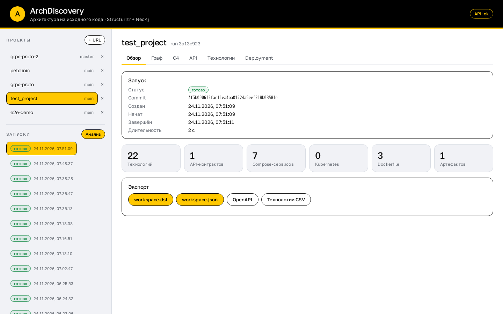
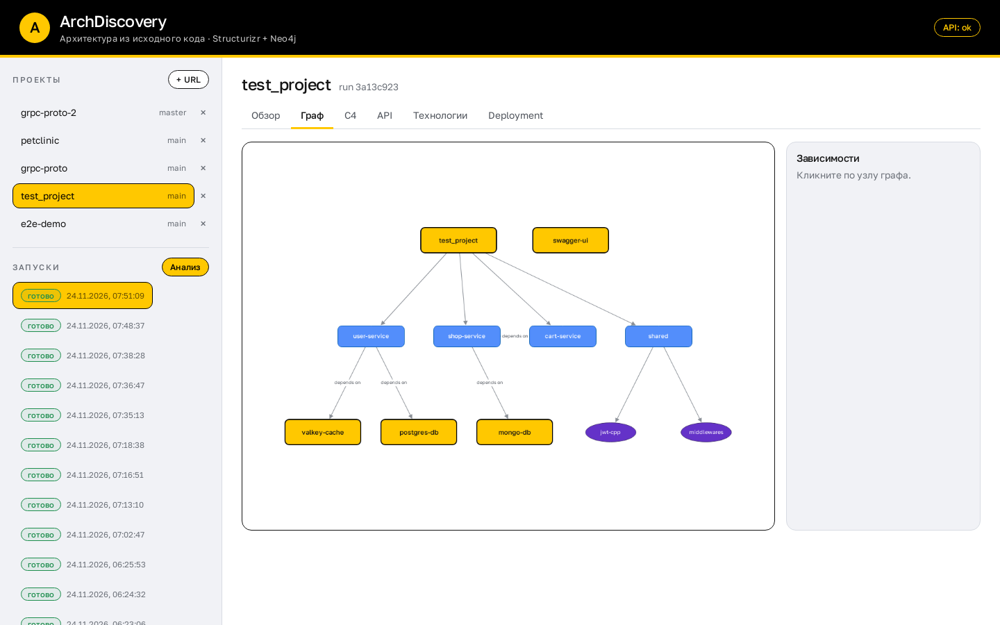
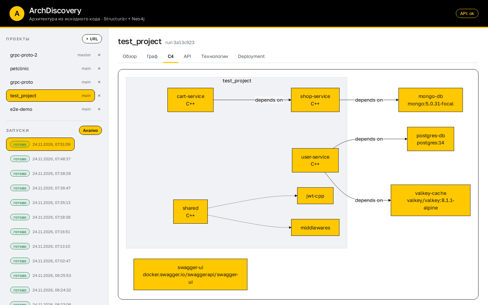

# Дизайн-система в веб-интерфейсе

Источник: брендбук **beeline_bb_2024.pdf** (разделы «цвет», стр. 27–29; «типографика», стр. 31–34).

## Палитра

| Роль | HEX | Применение |
|------|-----|------------|
| Beeline Yellow | `#FFC800` | акценты, активные элементы, кнопки, узлы-системы |
| Digital Black | `#141414` | текст, обводки карточек |
| Crystal White | `#FFFFFF` | фон, поверхности |
| Fuchsia | `#EC008C` | дополнительные акценты (не в основном UI) |
| Purple | `#6432C8` | узлы-компоненты |
| Teal | `#00C2AB` | резерв |
| Blue | `#538EFB` | узлы-контейнеры, статус running |
| Ink / Muted / Soft | `#141414` / `#4E535B` / `#6B7078` | иерархия текста |
| Gray / Line | `#F1F2F6` / `#D8DCE3` | фоны панелей, разделители |
| Green / Red | `#1E8E4E` / `#D92D20` | статусы done / failed |

## Типографика

- Гарнитура: **Beeline Sans**; fallback — **Golos Text** (подключается с Google Fonts), затем системные.
- Начертания: `regular` — основной текст, `medium` — заголовки, кнопки, выделения.
- `bold` не используется (по брендбуку — только в малых форматах).
- Заголовки — с отрицательным трекингом (`-0.02…-0.03em`), кикеры — uppercase с `letter-spacing`.

## Компоненты

| Элемент | Решение |
|---------|---------|
| Шапка | чёрный фон `#000`, жёлтая полоса-акцент, круглый жёлтый знак, белый заголовок |
| Кнопки | «пилюля» (`border-radius: 999px`), жёлтый фон, чёрная обводка, чёрный текст |
| Карточки/панели | белый фон, обводка `1px #141414`, радиус 14 px |
| Метрики | серый фон `#F1F2F6`, светлая обводка, крупное число medium |
| Табы | активный — жёлтая нижняя линия 3 px |
| Бейджи статусов | «пилюля» с семантическим цветом (green/red/blue/gray) |
| Граф (Cytoscape) | система — жёлтый, контейнер — синий, компонент — фиолетовый; рёбра серые |
| C4 (Mermaid) | светлая тема `base`, жёлтый primary, чёрные линии |
| API (Redoc) | светлый, primary-цвет `#FFC800` |

## Где в коде

- [web/src/styles.css](../web/src/styles.css) — токены и все компоненты.
- [web/src/components/GraphView.tsx](../web/src/components/GraphView.tsx) — палитра графа.
- [web/src/components/C4View.tsx](../web/src/components/C4View.tsx) — тема Mermaid.
- [web/index.html](../web/index.html) — подключение Golos Text, `theme-color`.

## Скриншоты

## Навигация

Вкладки доступны по hash-ссылкам: `#graph`, `#c4`, `#api`, `#tech`,
`#deployment` (например, `http://localhost:8080/#c4`).
